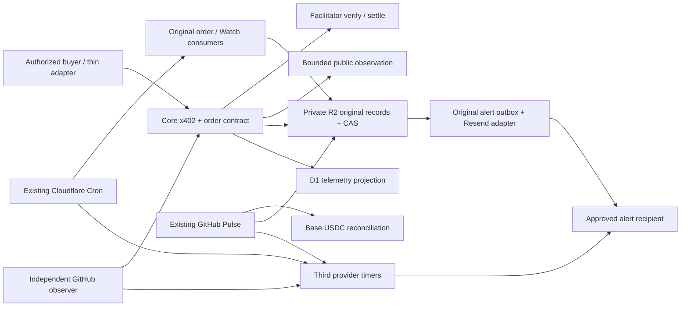

# DELTA final architecture

Reviewed 2026-11-04 Asia/Shanghai. This document describes the local candidate, not deployed configuration. The single release decision is [DELTA_FINAL_GO_NO_GO.md](DELTA_FINAL_GO_NO_GO.md); prior reports remain historical evidence.

## Version and authority

The working repository is `C:/Users/10122/Documents/ChatGPT/DELTA-local-repair-v1.1`. At intake HEAD was `b20f1b1`, clean, on `codex/cloud-operations-20261103`. Fetch confirmed remote master `455f7be8278205f78e2099b85c45867ba39163b6` is an ancestor, 21 local commits ahead, zero remote-only commits. This is not evidence of the deployed Worker revision. Other worktrees remain unchanged. [Inventory](../DELTA-final-production-20261104/baseline-inventory.json) records all 45 workflow definitions and their hashes.

Discovery Pulse remains the only business loop; its two candidate cron expressions partition the 24 hourly slots. The existing read-only operations observer now has a candidate five-minute schedule, gated at job level by both a default-off enable flag and exact approved SHA. Its publication and activation are not authorized by this document. The canonical Pulse additionally reports its own critical completion to an independent fourth deadman check. Historical one-shot workflows are not another recurring engine, but publishing changes to their path triggers could run them: exclude them from release scope. Hosted ChatGPT reporting is auxiliary and was not changed.

Post-login [production readback](docs/repair/cloudflare-readonly-20261104.md) now records live Core0.7.0/Gateway0.6.1, original resources, private proof preservation and actual Cron execution. The deployed Core annotation is a release side branch; the current candidate is not deployed. Current remote master has one hourly Pulse schedule and no candidate operations-observer workflow. The paragraph above describes the local candidate's workflows, not their live activation.

## Actual runtime

Cloudflare schedules are `*/3 * * * *` and `*/15 * * * *`, as declared in [wrangler.jsonc](wrangler.jsonc). The former is MeshKore heartbeat; the latter hosts Watch/index work and independently gated recovery/operating consumers. A configured cron is not proof it ran. [scheduled-operations](src/scheduled-operations.ts), [cron-observer](src/cron-observer.ts), [operating-state](src/operating-state.ts) and [pulse-watchdog](src/pulse-watchdog.ts) retain bounded outcomes, original task identity, lease/CAS evidence and uncertain dispatch states. No second business scheduler or durable service is created.

Persistence actually used: private R2 `PROOFS`, D1 `ANALYTICS_DB`, remote `BROWSER`; gateway has a `CORE` service binding. No Cloudflare Queues, Durable Objects or KV binding is declared. R2 state machines implement the existing queues; do not describe them as provisioned Queue services. R2 CAS and original action identities fence durable writes; leases alone cannot cancel an already dispatched external side effect, so unknown outcomes remain readback/reconciliation rather than new dispatch authority.

## Source of truth

| Fact | Authority | Non-authoritative views |
|---|---|---|
| Authorized request, settlement and delivery | Original Core order/payment/fulfillment/proof records | Dashboard, telemetry, worker exit status |
| Treasury received | Verified Base canonical USDC log, tx+log index, coverage/checkpoint | Wallet balance screenshot, 402, local fixture |
| Revenue, liability, refunds and costs | Original accounting join with verified supporting sources | Invoice notice, estimates, selected-view totals |
| Buyer relationship and suppression | Existing canonical operator pipeline and Gmail thread evidence | New invented CRM, directory presence |
| Release authority | Owner exact revision/scope approval + protected release environment | Local commit, tag, test count |

The operating dashboard remains a bounded private projection, not a new ledger. Missing or stale sources must remain UNKNOWN/STALE. Initial provider/resource inventory is now observed; a fresh pre-release snapshot, real external wiring and canonical operator freshness remain prerequisites. See [finance](DELTA_TREASURY_AND_COST_AUDIT.md), [notifications](DELTA_MONITORING_AND_ALERTING.md) and [business rules](DELTA_REVENUE_OPERATIONS.md).
