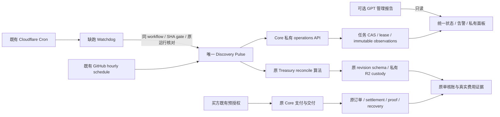

# DELTA 六阶段升级：剩余实施与验收合同

本轮接续 `f8caec8fedad62213afbfd79d3d669967b01e8e7`，工作树初始干净，分支 `codex/cloud-operations-20261103`。保留之前所有 v1.1 修复、原检查点、订单、价格与 Treasury。用户选择 Cloudflare 登录稍后处理，因此当前只完成本地实现和隔离验证，不声称已部署。用户提供的 GPT 主任务 disabled/failed/next=null 记录保留为来源陈述；本轮没有管理页实时回执，也不再把恢复该任务作为 Core 运行的前提。

## 唯一架构与权威

不新建第二个 Pulse、不另建产品、钱包或账本。任务状态只协调执行，不替代订单/链上收款/原 operator pipeline。新 R2 namespace 只使用 `operations/`；不读出、删除或公开历史私有 proof。队列是持久化状态机，不能宣称已接入所有业务消费者。

## 六阶段剩余内容与完成标准

| 阶段 | 本地已实现或沿用 | 上线前仍须完成 | 必须留存的验收证据 |
|---|---|---|---|
| 1. 审计与基线 | 前轮30天 GitHub审计、原 Cron实际职责、独立失败分类；本轮从精确提交增量实现 | 本人 OAuth 后读回真实 Worker版本、Cron、bindings、D1迁移状态、运行日志；对照聚合未发布差异 | 提供商实际配置、release SHA、读回时间；记录 unknown 和历史窗口，不能用提交标题代替生产证据 |
| 2. 独立云端调度 | 原每小时Pulse保留；现有15分钟Cron可调用同一workflow watchdog；Task ID/Run ID、CAS、租约、检查点、退避/死信/未知冻结 | 配置最小权限 GitHub Actions凭据、已批准release SHA；同一私有R2环境激活；验证真实运行与独立监控 | 关闭本机/ChatGPT后至少跨两个真实周期；故障注入漏触发、并发、失ACK、长任务、主分支漂移；不得额外重复POST或自动启用disabled workflow |
| 3. 自主经营 | 原需求扫描/规范渠道适配器保留；新资格投影把需求、预算、独立性、支付能力、购买授权分开 | 迁移原canonical operator数据的全部writer；真实Gmail/SENT或平台读回、拒绝/抑制/同目标去重；既有授权下接真实成交适配器 | 用同一真实目标验证首触达一次、拒绝停止、沉默不催、明确新回复推进；旧attempt/unknown不重发；预算证据而非平台宣传。不得复活已关闭旧sprint或建立平行pipeline |
| 4. 支付与履约 | 复用已修Core的prepare、原payment identity、settlement gate、query/recover/export、预付Watch/outbox、薄SDK/伙伴网关 | 真实生产原订单与settlement/proof inventory；经过资格审查后接后台恢复消费者；适配当前实际外部业务合同 | 同一原单中断/重试/跨版本恢复，保留付款、额度、历史价格、私有原件；不重签/重购/删锁；付款未交付优先于获客。买方合法预授权仍自动购买，不增加逐单人工审批 |
| 5. 收款、成本与利润 | 原Treasury算法接可选远端custody；原schema、hash链、分段/overlap、唯一tx+logIndex、确认要求不变；RPC来源保留 | 批准并迁移真实原origin/floor/history，不能拿短区间审计造空库；确认全部writer使用同一authority；跨运行RPC健康提示与实际账单/退款/渠道成本读入 | 中断后新runner继续原cursor，不漏扫/重计/覆盖证据；收款逐笔关联独立目的、订单、交付、退款与实际费用。没有完整join则收入/实际成本/毛利null |
| 6. 监控、报告与经营面板 | 同一私有status/dashboard；分层指标、告警规则、重复/升级/确认判定；Pulse原观测入R2并核对精确摘要及pointer | 接批准的通知目的地及其授权、持久alert outbox/episode history和实际发送器；开通不暴露admin secret的owner只读入口；接原单/原operator事实适配器 | 结果保存后独立读回；provider accepted与送达分开；通知失ACK原ID核对、不重复发送；unknown/partial/stale可见；定时缺跑仍能被另一层观察 |

阶段3、4、5、6的未接消费者/外部事实不由Task库、纯投影或健康检查自动补齐。禁止将此表所有行标为“完成”。最终商业验收仍是独立外部买方 Discover→Evaluate→Pay→Fulfill→Verify，canonical USDC进入指定Treasury且真实贡献毛利为正；不是可保证的开发交付日期。

后续本地增量从 `22233e3` 接续：已加入[原付费交付草稿恢复消费者](paid-order-draft-recovery.md)，复用原订单、确认结算、保留条款、原件验证和最终CAS，只恢复已完整保存的原草稿。接既有15分钟Cron和私有status，独立flag默认关闭；逐单与整页超时、同事件预留、原记录回读和游标CAS均有限制。此增量不能将表中“后台恢复消费者”整体勾为完成：仍缺付费未交付优先队列、其他产品/历史合同覆盖、真实生产存量与吞吐验收。未接告警发送器、真实费用/退款/独立客户事实和canonical operator全部writer的缺口仍在。

## 告警与报告：补全截断处

详见 [告警合同](alerts-and-acceptance.md)。下列是本次明确制定的候选默认值，不是恢复出来的原文：

- 最近执行开始超过3个声明周期，并有新鲜的提供商启用/周期证据：SEV2；连续3次失败需有连续历史，不从一个失败猜测。
- 同一已核实付款订单超过300秒未交付：SEV1；原始condition时间不因重新扫描而清零。
- 到账未匹配、明确区块覆盖缺口、权限失效/撤销：SEV2。短区间0转账不能变成累计0收入。
- 实际负贡献毛利：SEV2；仅模型预估为负：SEV3。缺成本不是0成本。
- 未确认通知或失效通知权限：本地SEV2记录，不递归向坏通道发消息。
- 未确认1小时后具备升级候选；同episode+severity+stage去重。已排队/提供商接受/结果未知先核对原通知。明确ACK才抑制，条件消失于不完整快照不当作已解决。

每轮报告包含检查时间、来源、task/run/release、声明周期、实际开始/完成/耗时、上次成功、下次运行或unknown、覆盖/缺口、各lane结果、保存回执、通知回执，以及九个独立财务阶段。没有依据的失败率、恢复次数、全体客户/潜客总数、下一次触发均为null；只对本快照可验证行计数。报价/402/上架/邮件发送不计客户收入。

## 具体接线与启用顺序

1. 私有 `/internal/operations/*` 需要 `OPERATIONS_CLOUD_ENABLED=true` 和provider secret `OPERATIONS_ADMIN_SECRET`。拒绝Browser Origin、支付头和URL凭据；no-store/noindex。机器可读status和HTMLdashboard是同一投影，不能把admin secret放浏览器localStorage、URL、仓库或截图。
2. 同一值在GitHub provider secret store使用 `DELTA_OPERATIONS_ADMIN_SECRET`，仅传给Treasury和publisher步骤，不传给各市场扫描器。`DELTA_OPERATIONS_CLOUD_ENABLED=true` 时，最后gate要求publisher实际成功；发送一次原观测后按run_id读回**同SHA、完整原JSON摘要和pointer**，不能只凭HTTP200。
3. `TREASURY_CUSTODY_ENABLED=true`、批准的origin和最低revision/digest必须从真实原记录核对。`TREASURY_CUSTODY_ALLOW_BOOTSTRAP`默认未设；不能因为空列表、缺权限或旧报告便设成true。CLI `DELTA_TREASURY_STATE_MODE=remote` 时拒绝同时指定本地目录或调用方新origin，没有fallback到短窗口掩盖远端失败。
4. 在同一个release配置 `OPERATIONS_RELEASE_SHA`，再配置 `PULSE_WATCHDOG_ENABLED=true` 和仅限本repo Actions write/read的 `GITHUB_ACTIONS_DISPATCH_TOKEN`。Worker原15分钟触发器观察唯一Pulse；3小时陈旧才补触发。先持久task+全局guard，再单次POST；unknown保留原guard，不换ID重发。原run仍queued/in-progress即使不在最近10条也阻止新POST。
5. Watchdog输入携带原run UUID和预期release SHA；GitHub job在实际`github.sha`不匹配时不执行。补触发为workflow_dispatch，原daily maintenance判定为false，不执行注册/渠道更新。原schedule下已合法授权的daily维护配置须原位迁移，不得静默关闭后声称恢复。
6. 先只读核验、在批准隔离范围实际验收，再按发布范围激活。不新增付费服务、不做owner canary、不动钱包权限、不迁移未知订单、不停止现有Core任务。提供商要求的OAuth、最小权限令牌录入和通知目的地授权是一次性外部接入条件；当前Cloudflare登录已由用户明确延期，本轮不再次催促。

## 真实上线验收矩阵

| 注入/事件 | 预期结果 | 不允许的替代 |
|---|---|---|
| 电脑/手机/家庭网全断 | 既有云端周期仍产生可读run与保存回执 | 用本机手动运行或GPT输出代替 |
| GitHub schedule漏/迟到 | 不新建Pulse；watchdog单次补原workflow，恢复实际运行时间 | 用workflow绿或创建事件当业务已运行 |
| 两个watchdog并发 | 全局ETag只有一个POST许可 | 同时两个POST后靠列表去重 |
| POST丢ACK/204兼容 | 原guard/task冻结或按精确原run核对恢复 | 换UUID再次POST |
| master在预检后漂移 | 实际run SHA gate拒绝执行；读回不把别的release当原动作 | 只比较预检SHA |
| RPC429/5xx/节点切换/中断 | 原区块覆盖、去敏来源、partial cursor保留，新runner续扫 | 写0收入、清checkpoint或重置origin |
| R2写失ACK/迟到commit | 保留原revision；只读同版本摘要；旧CAS不能覆盖新状态 | 删除锁、重造空库或认为timeout=未写入 |
| 已付原单交付中断 | 原付款/订单/证据恢复；明确未完成就优先服务 | 重签付款、再扣一次、删除不明订单 |
| 单平台500/索引失败 | 仅本lane degraded；收款/订单和其余lane继续 | 关闭整个scheduler或整轮重跑 |
| 不变告警/原通知未知 | 同episode不重复发送；ACK/升级/送达证据分开 | 把请求发出当人已收到 |
| 平台验证/自测入账 | 保留tx证据但不计客户收入 | 把探针当First Stranger Revenue |

官方依据：[R2一致性/原子条件写](https://developers.cloudflare.com/r2/reference/consistency/)、[R2 Workers API](https://developers.cloudflare.com/r2/api/workers/workers-api-reference/)、[GitHub workflow dispatch及2026 API响应](https://docs.github.com/en/rest/actions/workflows)。这些说明提供商接口合同，不证明本部署已启用或验收。

## 本轮本地组合证据

`04-cloud-all-gates-1`：66个测试文件，**994 PASS / 1明确不适用的fallback内部实现用例SKIP**，网络隔离、源码指纹稳定。加载经摘要核验的 `0dbf2b3963ff56641b96e95b8f358591514cb3c4` 兼容候选和 `0a7ef80cf210263ced2ba197c8461535c1ac350b` 历史producer的精确本地构建。TypeScript检查通过。Node混跑不是Cloudflare provider-runtime或线上回退验收。

同时启用原先明示opt-in的有限工作量：200笔synthetic订单、并发8、60,095毫秒、4,088次附加恢复查询；100正常完成、50原单恢复、25结算未知、25原件不一致。每原付款最多一次，Browser mock175次且后续恢复不增加；原件哈希与对象集合保持稳定。Treasury实际到账、真实收入、实际成本与毛利仍null，不把synthetic付款计收入。

扩展混跑第一次保留6个失败：旧测试曾预期注入Webhook失败等场景的Cron仍返回成功。仅更新其观测契约断言：已知失败必须精确报`scheduled_operations_degraded`；真正并发CAS允许成功或该唯一降级，其他错误仍失败。原额度、事件ID、原body/HMAC、通知尝试次数、Browser次数、原件hash与迟到写断言未改，已独立复核。原失败证据保留，随后混跑75 PASS/3当时未加载场景SKIP；完整历史/工作量加载后的最终结果为上述994/1。

构建、源码、命令和私有验收清单在本机 `DELTA-cloud-operations-20261103` 证据目录，均create-only；没有push、provider注册/调用、生产迁移、资金动作或R2删除。当前状态仍是**本地已修、隔离测试通过、待发布、线上待验收、商业待外部验证**。
